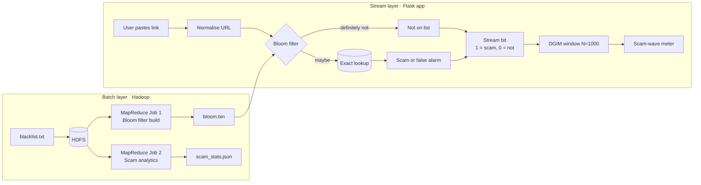
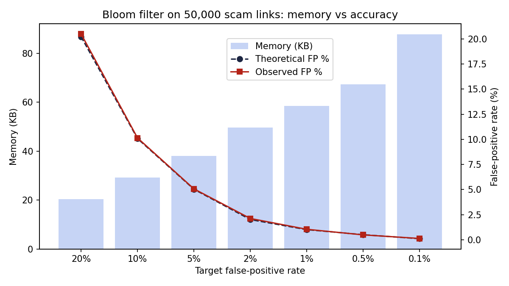
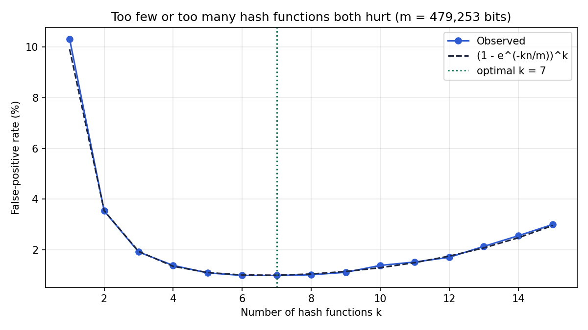
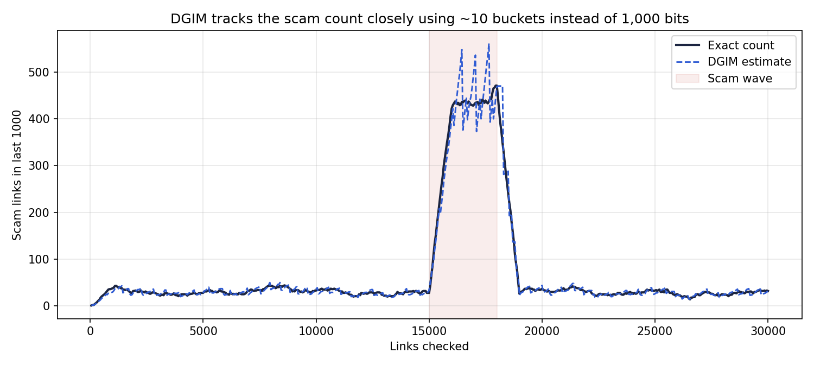
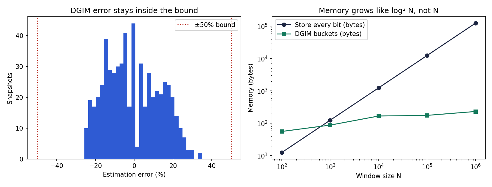

<div align="center">

# 🛡️ SafeLink

### Check a link before you open it

A scam-link checker with live scam-wave alerts, built on **Bloom Filters**, **DGIM** and **MapReduce**.


</div>

---

## The problem

Fake KYC, bank, electricity-bill and parcel-delivery links spread on WhatsApp and SMS every day. A checker serving millions of people has to answer two questions instantly:

| Question | Why it's hard | Our answer |
|---|---|---|
| Is this link a known scam? | The scam list has lakhs of links; storing and searching it for every check is costly | **Bloom Filter** |
| Is a scam wave happening right now? | Checks arrive as an endless stream; we can't store all of it | **DGIM** |
| How do we build the filter and study the scam list? | The list itself is big data | **MapReduce on Hadoop (HDFS)** |

## What it does

Paste a link and get one clear answer:

- 🔴 **Don't open this link.** It's on the known scam list.
- 🟠 **This link looks suspicious.** Not on the list, but it shows fake-website signs (bank name + bait word, odd domain ending, raw IP, many hyphens). One click reports it, and the Bloom Filter learns it instantly.
- 🟢 **Not on the scam list.**

A **scam activity meter** (Calm → Rising → Scam wave) shows when many scam links are being checked at once.

## How it works



The Bloom Filter answers first and the exact database is queried only on a "maybe", the same design Google Chrome Safe Browsing used. In our runs, **about 87% of checks never touch the database.**

## Concepts covered

| Concept | Where | What it shows |
|---|---|---|
| **Bloom Filter** | `core/bloom_filter.py` | Optimal `m` and `k`, double hashing, zero false negatives, live inserts |
| **DGIM** | `core/dgim.py` | Power-of-2 buckets, max 2 per size, merging, half-oldest-bucket estimate |
| **MapReduce** | `mapreduce/` | Mapper, combiner, shuffle/sort, reducer via Hadoop Streaming |
| **HDFS** | README commands | Blocks, replication, `fsck`, `put` / `getmerge` |
| **Stream processing** | `app.py` | Every check is a bit in an unbounded stream |

## Screenshots

<table>
<tr>
<td width="62%"><br><sub><b>How it works</b>: live Bloom bit positions, DGIM buckets, estimate vs exact chart, MapReduce analytics</sub></td>
<td width="38%"><br><sub><b>Mobile, dark mode</b></sub></td>
</tr>
</table>

## Quick start

```bash
git clone https://github.com/katkarvismaya19-web/Safelink-BDA.git
cd Safelink-BDA
pip install -r requirements.txt

python data/download_feeds.py        # real live scam feeds (OpenPhish + URLhaus)
# or: python data/generate_sample_data.py   (offline synthetic sample)

python mapreduce/run_local.py        # run both MapReduce jobs
python app.py                        # open http://127.0.0.1:5000
```

Generate the report charts with `python experiments/evaluate.py` (saved to `experiments/results/`).

<details>
<summary><b>Run on a real Hadoop cluster</b></summary>

```bash
# m and k for n URLs at 1% false positives (run_local.py also prints these)
python -c "from core.bloom_filter import optimal_params; n=sum(1 for _ in open('data/blacklist.txt')); print(optimal_params(n,0.01))"

hdfs dfs -mkdir -p /safelink
hdfs dfs -put data/blacklist.txt /safelink/
hdfs fsck /safelink/blacklist.txt -files -blocks

# Job 1: Bloom filter
hadoop jar $HADOOP_HOME/share/hadoop/tools/lib/hadoop-streaming-*.jar \
  -cmdenv BLOOM_M=<m> -cmdenv BLOOM_K=<k> \
  -input /safelink/blacklist.txt -output /safelink/bloom_out \
  -mapper bloom_mapper.py -combiner bloom_reducer.py -reducer bloom_reducer.py \
  -file mapreduce/bloom_mapper.py -file mapreduce/bloom_reducer.py
hdfs dfs -getmerge /safelink/bloom_out bloom_part.txt
python mapreduce/build_from_hadoop_output.py bloom_part.txt <m> <k>

# Job 2: scam analytics
hadoop jar $HADOOP_HOME/share/hadoop/tools/lib/hadoop-streaming-*.jar \
  -input /safelink/blacklist.txt -output /safelink/stats_out \
  -mapper stats_mapper.py -combiner stats_reducer.py -reducer stats_reducer.py \
  -file mapreduce/stats_mapper.py -file mapreduce/stats_reducer.py
```
</details>

## Results

Measured on 50,000 scam links.

| Metric | Result |
|---|---|
| Bloom Filter memory | **58.5 KB** vs ≈ 4.3 MB for a normal set (~75× smaller) |
| Hash functions | 7 (optimal for 1% target) |
| False positives | 1.00% theoretical, **1.04% observed** |
| False negatives | **0** (guaranteed) |
| Database lookups avoided | ~87% |
| MapReduce build vs direct build | Bit-for-bit identical |
| DGIM memory (N = 1,000) | **~10 buckets** (~80 bytes) vs 1,000 bits |
| DGIM error | ~12% mean, ~35% max (bound: 50%) |
| DGIM buckets at N = 1,000,000 | ~29 |

<table>
<tr>
<td></td>
<td></td>
</tr>
<tr>
<td></td>
<td></td>
</tr>
</table>

## Project structure

```
Safelink-BDA/
├── app.py                         Flask app: checker + "How it works" dashboard
├── templates/index.html           Web UI (no external libraries, works offline)
├── core/
│   ├── bloom_filter.py            Bloom filter
│   ├── dgim.py                    DGIM
│   └── url_utils.py               URL normalisation
├── mapreduce/
│   ├── bloom_mapper.py / bloom_reducer.py    Job 1: build Bloom filter
│   ├── stats_mapper.py / stats_reducer.py    Job 2: scam analytics
│   ├── run_local.py               Simulates Hadoop: split → map → combine → shuffle → reduce
│   └── build_from_hadoop_output.py
├── data/
│   ├── download_feeds.py          Real feeds: OpenPhish, URLhaus
│   └── generate_sample_data.py    Synthetic India-style scam links
├── experiments/evaluate.py        Charts and numbers for the report
└── docs/screenshots/
```

## Demo walkthrough

1. **Check a link** → *a known scam link* → red verdict.
2. *A fake-looking bank link* → amber with reasons → **Report as scam** → check again → now red.
3. **How it works** → see the 7 bit positions for the last link (all 1 = maybe, any 0 = definitely not).
4. **Simulate 500 normal checks** → meter stays calm. **Simulate a scam wave** → chart crosses the red line.
5. Point out the DGIM buckets (1, 1, 2, 2, 4, 8 …) and the MapReduce analytics.

<details>
<summary><b>Viva questions</b></summary>

- **Why not a normal set or database?** At crore scale a set needs GBs of RAM; the Bloom Filter needs MBs and can live on a phone or edge server.
- **Can a Bloom Filter miss a scam?** No. False negatives are impossible; false positives are cleared by the exact lookup.
- **How do you delete a link?** You can't; clearing a bit may affect other links. Use a Counting Bloom Filter or rebuild with MapReduce.
- **Why at most 2 buckets per size in DGIM?** It keeps the oldest bucket small relative to the total, bounding error at 50%. With r buckets per size, error ≤ 1/(r−1).
- **Why is the reducer safe as a combiner?** Both jobs sum counts, and sum is associative and commutative. An average would not be safe.
- **Why check both the full URL and the domain?** Some feeds list whole scam domains; others list one page on a hacked site.
</details>

## Limitations and future scope

- A link not on the list isn't proof of safety; the pattern check helps but can be fooled.
- Add Flajolet-Martin for unique scam links per day, a Counting Bloom Filter for deletions, per-city wave alerts, a WhatsApp bot or browser extension, and Spark Streaming for real-time scale.
- The sample dataset is synthetic; use `data/download_feeds.py` for real live feeds.

---

<div align="center"><sub>Big Data Analytics mini project · Bloom Filter + DGIM + MapReduce</sub></div>
